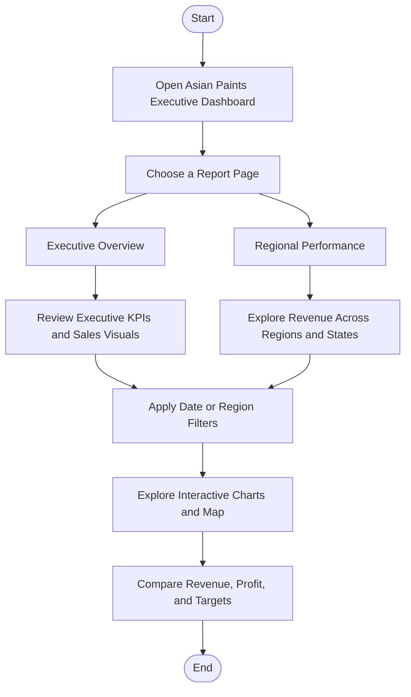
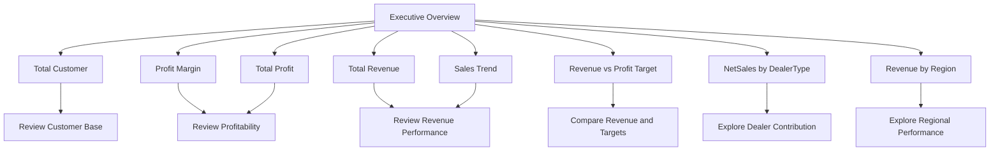
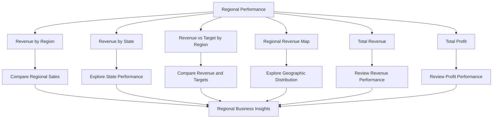
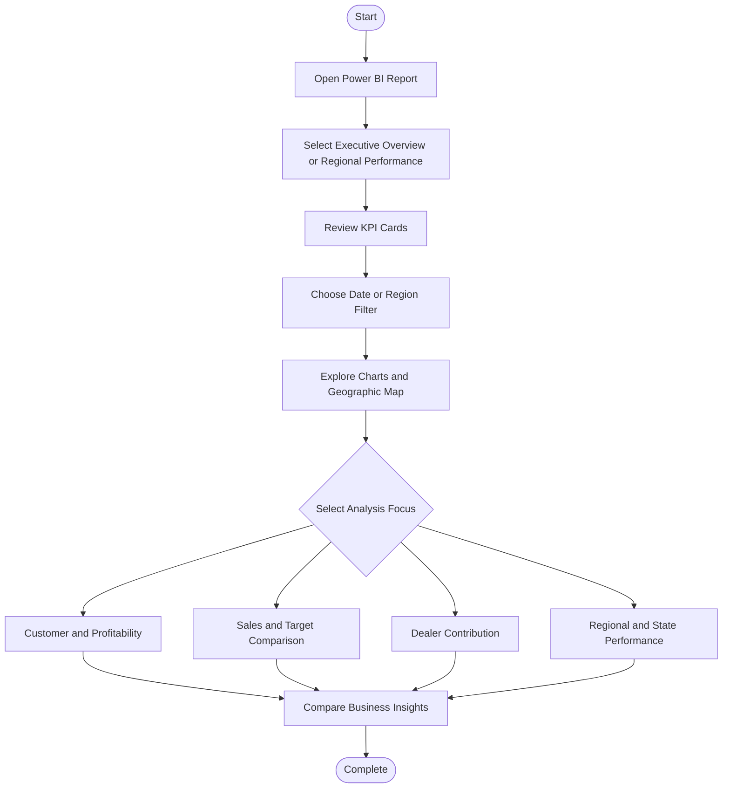

# Asian Paints Executive Dashboard

An interactive Power BI dashboard for exploring sales performance, revenue, profit, profit margin, customer metrics, dealer contributions, and regional business performance.

## Project Overview

The **Asian Paints Executive Dashboard** brings executive-level business metrics and regional sales analysis together in one Power BI report. It helps users review revenue and profit performance, compare actual revenue with targets, understand dealer-type contribution, and explore revenue across regions and states.

The report contains two pages:

1. **Executive Overview**
2. **Regional Performance**

Both pages use KPI cards, interactive charts, geographic mapping, and slicers to support business exploration.

## Dashboard at a Glance

| Report Page | Main Focus | Key Analysis |
|---|---|---|
| Executive Overview | Overall business performance | Total customers, profit margin, total profit, total revenue, sales trend, revenue versus profit target, dealer-type contribution, and regional revenue |
| Regional Performance | Geographic sales performance | Revenue by region, revenue by state, revenue versus target by region, profit by region, and regional geographic distribution |

## Dashboard Navigation Flowchart



## Page 1: Executive Overview

The Executive Overview page provides a consolidated view of business performance through customer, revenue, profit, dealer, and regional metrics.

### Key Performance Indicators

| KPI | Report Measure / Field | Business Purpose |
|---|---|---|
| Total Customer | `DimAccount[Total customer]` | Shows the total customer measure |
| Profit Margin | `DimAccount[Profit Margin]` | Highlights the profit margin |
| Total Profit | Sum of `FactSales[ProfitAmount]` | Shows total profit |
| Total Revenue | Sum of `FactSales[SalesAmount]` | Shows total revenue |

### Visualizations

| Visualization Title | Chart Type | Fields Used | Purpose |
|---|---|---|---|
| Sales Trend | Line chart | `DimDate[Date]` with Year hierarchy, `FactSales[NetSales]` | Explores net sales across years |
| Revenue vs Profit Target | Line and clustered column combo chart | Date hierarchy, `FactSales[NetSales]`, `FactTargets[ProfitTarget]` | Compares net sales with profit target across dates |
| NetSales by DealerType | Treemap | `DimDealer[DealerType]`, `FactSales[NetSales]` | Shows net sales contribution by dealer type |
| Revenue by Region | Shape map | `DimBranch[Region]`, `FactSales[NetSales]` | Displays revenue geographically across regions |

### Interactive Filters

| Slicer | Field | Usage |
|---|---|---|
| Date | `DimDate[Date]` | Explore business performance over a selected date range |
| Region | `DimRegion[Region]` | Focus on a selected region |

### Executive Overview Analysis Flow



## Page 2: Regional Performance

The Regional Performance page focuses on revenue and profit across geographic areas. It supports analysis from region to zone, state, and city, with dedicated regional filters and geographic mapping.

### Key Performance Indicators

| KPI | Report Measure / Field | Business Purpose |
|---|---|---|
| Total Revenue | Sum of `FactSales[SalesAmount]` | Shows total revenue |
| Total Profit | Sum of `FactSales[ProfitAmount]` | Shows total profit |
| Profit Margin | `DimAccount[Profit Margin]` | Highlights profit margin |
| Total Customer | `DimAccount[Total customer]` | Shows the total customer measure |

### Visualizations

| Visualization Title | Chart Type | Fields Used | Purpose |
|---|---|---|---|
| Revenue by Region | Clustered bar chart | `DimRegion[Region]`, `FactSales[NetSales]` | Compares net sales across regions |
| Revenue vs Profit Target | Clustered bar chart | `DimDealer[State]`, `FactSales[NetSales]` | Compares net sales across states |
| Revenue vs Target by Region | Line and clustered column combo chart | `DimRegion[Region]`, `FactTargets[RevenueTarget]`, `FactSales[NetSales]`, `FactSales[ProfitAmount]` | Compares revenue target, net sales, and profit by region |
| Revenue by Region | Shape map | `DimBranch[Region]`, `FactSales[NetSales]` | Presents regional revenue geographically |

### Interactive Filters

| Slicer | Field | Usage |
|---|---|---|
| Region | `DimRegion[Region]` | Explore a selected region |
| Date | `DimDate[Date]` | Explore regional performance over a selected date range |

### Regional Performance Analysis Flow



## Data Model

The report visuals reference the following model tables:

| Table | Role in the Dashboard |
|---|---|
| `DimDate` | Date attributes and time-based analysis |
| `DimRegion` | Region information and regional filtering |
| `DimBranch` | Branch region information for geographic analysis |
| `DimDealer` | Dealer type and state information |
| `DimAccount` | Customer and profit margin measures |
| `FactSales` | Sales, net sales, and profit values |
| `FactTargets` | Revenue and profit target values |

### Main Fields and Measures

| Field / Measure | Table | Dashboard Usage |
|---|---|---|
| `Total customer` | `DimAccount` | Total Customer KPI |
| `Profit Margin` | `DimAccount` | Profit Margin KPI |
| `SalesAmount` | `FactSales` | Total Revenue KPI |
| `ProfitAmount` | `FactSales` | Total Profit KPI and regional comparison |
| `NetSales` | `FactSales` | Sales trend, dealer contribution, and regional revenue |
| `ProfitTarget` | `FactTargets` | Revenue vs Profit Target visual |
| `RevenueTarget` | `FactTargets` | Revenue vs Target by Region visual |
| `Date` | `DimDate` | Date slicer and sales trend |
| `Region` | `DimRegion`, `DimBranch` | Region slicer, chart, and map |
| `DealerType` | `DimDealer` | Dealer contribution treemap |
| `State` | `DimDealer` | State-level revenue comparison |

## End-to-End Business Analysis Workflow



## Visualization Guide

| Visualization | Best Use | Dashboard Application |
|---|---|---|
| KPI Card | Highlighting an important business metric | Total Customer and Profit Margin |
| KPI Visual | Showing a key measure with a trend or target context | Total Profit and Total Revenue |
| Line Chart | Exploring changes across time | Sales Trend |
| Line and Clustered Column Combo Chart | Comparing multiple measures in one visual | Revenue versus targets |
| Treemap | Comparing contribution across categories | NetSales by DealerType |
| Clustered Bar Chart | Comparing values across geographic categories | Revenue by Region and State |
| Shape Map | Presenting geographic performance | Revenue by Region |
| Slicer | Interactive report filtering | Date and Region |

## Business Questions Explored

The dashboard supports exploration of questions such as:

1. What is the total revenue?
2. What is the total profit?
3. What is the current profit margin measure?
4. How many customers are represented by the customer measure?
5. How does net sales change across years?
6. How does revenue compare with profit targets over time?
7. Which dealer types contribute to net sales?
8. How does revenue vary across regions?
9. Which states show different net sales performance?
10. How do revenue target, net sales, and profit compare across regions?
11. How does regional performance change when the date filter is adjusted?
12. How does the selected region contribute to overall business performance?

## How to Use the Dashboard

1. Open `pr_5.pbix` in Microsoft Power BI Desktop.
2. Select **Executive Overview** to explore overall business performance.
3. Select **Regional Performance** to explore geographic sales performance.
4. Use the Date and Region slicers to focus the analysis.
5. Review the KPI cards to understand the selected business context.
6. Explore charts and the geographic map to compare regions, states, dealer types, revenue, and targets.
7. Select chart elements to explore related information across the report.
8. Change the slicers to compare different dates and regions.

## Project Structure

```text
Asian-Paints-Executive-Dashboard/
│
├── pr_5.pbix
└── README.md
```

## Tools and Technologies

| Tool / Technology | Purpose |
|---|---|
| Microsoft Power BI Desktop | Dashboard development and reporting |
| Power BI KPI Visuals | Revenue, profit, customer, and margin indicators |
| Power BI Charts | Sales trends, target comparisons, and dealer analysis |
| Power BI Treemap | Dealer-type contribution analysis |
| Power BI Shape Map | Geographic revenue analysis |
| Power BI Slicers | Interactive date and region filtering |
| Mermaid | Flowcharts and workflow diagrams |
| Markdown | Project documentation |

## Project Summary

The **Asian Paints Executive Dashboard** combines executive business metrics and regional sales analysis in one interactive Power BI report.

Its two report pages provide focused views of customers, revenue, profit, profit margin, sales trends, target comparisons, dealer-type contribution, and geographic performance. KPI visuals, line charts, combo charts, treemaps, bar charts, maps, and interactive slicers make it easy to explore business performance from both executive and regional perspectives.

---

**Project Name:** Asian Paints Executive Dashboard  
**Power BI File:** `pr_5.pbix`  
**Documentation File:** `README.md`
